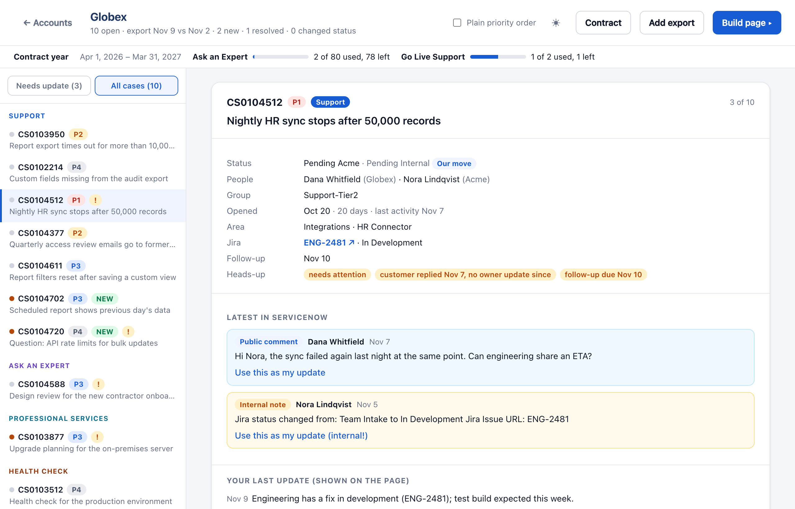
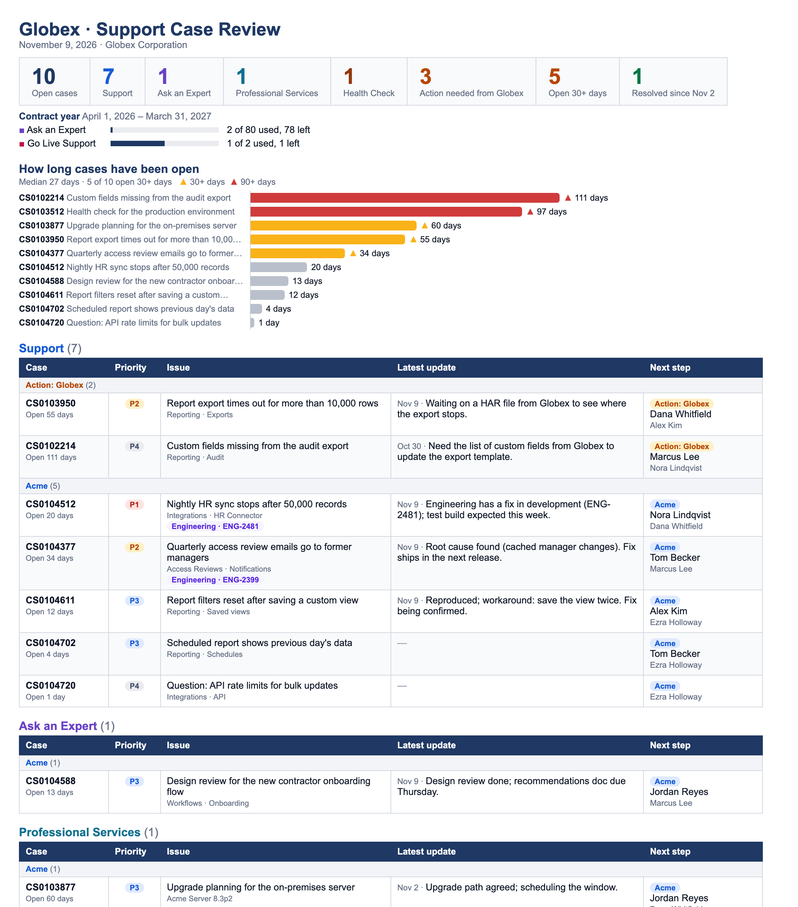

# TAM case review

Turns a ServiceNow case export plus your status updates into a clean page you
present to the customer. Python 3 standard library only.

<picture>
  <source media="(prefers-color-scheme: dark)" srcset="docs/images/app-dark.png">
  
</picture>

Walk through each case, write what the customer should hear (or reuse a ServiceNow
comment), and build the page you present on the call:

Internal signals such as "customer replied, no owner update since", follow-ups due and
cases needing attention stay in your prep view and never reach the customer page.
The app has a Light / Dark / System switch (◐ in the top bar).

### Try it with the demo

`demo/` holds a fictional account (Globex, served by the example vendor Acme):

    TAM_DATA_DIR=demo TAM_PROFILE=profiles/example.json python3 callprep.py globex --no-update

In the desktop app, point **Settings → Data folder** at the `demo` folder.

Your organization's names (company, case types, Jira address) go in `profile.json`,
not the code. Copy [profiles/example.json](profiles/example.json) to `profile.json` and
edit it. See "Your organization's profile" in [docs/servicenow-view.md](docs/servicenow-view.md).
Without one, everything works with neutral defaults.

**Not comfortable with Terminal?** Use the desktop app, **TAM Case Review**: same
review, same page, with buttons. Coworkers only need the installer, see
[app/INSTALL.md](app/INSTALL.md). The rest of this README covers the command-line version.

## Desktop app (building it)

The app lives in `app/` and runs on the same `callprep.py` logic, so the page, CSV and
Gainsight text come out exactly the same.

- **Mac:** `bash app/build_mac.sh` → `app/dist/TAM Case Review.dmg` (send this).
- **Windows:** on a Windows PC, double-click `app\build_windows.bat` →
  `app\dist\TAM Case Review Setup.exe` (needs Python from python.org, plus
  [Inno Setup](https://jrsoftware.org/isinfo.php) for the installer; without it you get a zip).
- **No Windows PC:** push this folder to a *private* GitHub repo (`.gitignore` keeps
  `exports/`, `notes/` and `out/` out of it) and run the **Build apps** workflow from the
  Actions tab. It builds both installers.

The app keeps its data in `Documents/TAM Case Review` (or in `Documents/tam-toolkit` if
that already has an `exports` folder, so command-line users keep their history). Settings →
Change… picks another folder. Version number: `VERSION` in `app/tam_app.py` and
`AppVersion` in `app/installer.iss`.

The builds aren't signed with an Apple Developer ID or a Windows code-signing certificate,
so first launch shows a warning (INSTALL.md walks through it). If the company has
signing certificates, signing the `.app`/`.exe` removes the warnings.

## Install (once)

You need Python 3.9 or newer and this folder. Nothing else to install.

**Mac**

1. Open Terminal and run `python3 --version`. If it prints a version, you're
   set. If macOS offers to install the "command line developer tools", accept,
   wait for it to finish, and run the check again. (Or install Python from
   python.org/downloads.)
2. Copy the `tam-toolkit` folder into `Documents`.
3. Test it:

       cd ~/Documents/tam-toolkit
       python3 callprep.py --help

**Windows**

1. Install Python from python.org/downloads. On the first installer screen,
   tick **"Add python.exe to PATH"** before clicking Install.
2. Copy the `tam-toolkit` folder into `Documents`.
3. Open **Windows Terminal** (or PowerShell) and test it:

       cd ~\Documents\tam-toolkit
       py callprep.py --help

   Use `py` wherever these steps say `python3`. Typing `python3` on Windows can
   open the Microsoft Store instead.

Windows differences:
- Pasting several lines at once does **not** join them into one update. Each
  line lands on the next case. Paste one line at a time, or join the text into
  one line first.
- The Ctrl+A / Ctrl+E / Ctrl+U / Ctrl+K / Ctrl+W keys don't work. Use the
  arrows, Home / End, and Esc (clears the line).
- Use Windows Terminal. The old Command Prompt window can show the colors as
  codes like `←[1;32m`.
- Copy the page with Ctrl+A, Ctrl+C.

Sharing the toolkit: send `callprep.py`, `README.md` and your team's `profile.json`. Each person
creates their own `exports/`, `notes/` and `out/` folders. Those folders hold
customer case data, so don't pass yours along.

## Each review

1. **Export** the account's open cases from ServiceNow into `exports/<account>/`.
   The first time: **Create a new list** → select your customer's list (or create one
   from scratch) → add a condition **Customer account** is **Acme** → add the columns
   in **Select columns** ([docs/servicenow-view.md](docs/servicenow-view.md)) → **Create**.
   Then, in the list shown, press **Export**. Next time, open the saved list and press
   **Export**. Save it as, e.g.,
   `exports/acme/acme_tickets-10-8.xlsx`. Keep the date in the filename.

2. **Run it:**

       cd ~/Documents/tam-toolkit
       python3 callprep.py acme

   (`python3 callprep.py` on its own lists your accounts to pick from.)

3. **Type your updates.** It walks you through each case, showing its type,
   status change, people, Jira ticket and status, the latest public comment and
   latest internal note from ServiceNow (cleaned up and wrapped), and your last
   update:
   - type the update and press Enter to save it
   - press Enter alone to copy the newest ServiceNow comment or work note (the
     `enter` line shows exactly what will be copied). Greetings and sign-offs are
     trimmed. If your own update is newer, Enter keeps yours.
   - type `s` to skip and leave the case as it is
   - editing keys work while typing: arrows, Ctrl+A / Ctrl+E (start / end), Ctrl+U
     (clear the line), Ctrl+K (clear to the end), Ctrl+W (delete a word)
   - pasting several lines at once (an email, a ServiceNow comment) saves them as
     one update on that case
   - type `q` to finish early (what you typed so far is saved)

   Copied entries are tagged `[comment]` or `[internal note]` in the notes file.
   The tags don't appear on the page, but cases showing a copied internal note
   are listed under "Before the call". Set `AUTOFILL = "public"` to copy only
   customer-visible comments, or `"off"` to make Enter keep your last update.

   On later runs it offers just the cases with activity since your last update.

4. **Present.** The page opens in your browser. Present from there, or copy it
   all (Cmd+A, Cmd+C) and paste into OneNote.

5. **Log it in Gainsight.** A plain-text version (`.txt`, no tables) is copied
   to the clipboard at the end of every run. Paste it into the Gainsight
   activity Note. If you've copied something else since, open the `.txt` in
   `out/<account>/` and copy it from there.

## What the customer sees

- Headline numbers: open cases, one count per case type, action needed from
  them, and resolved since the last export
- A focus-area line when one product area or topic dominates (for example Reports)
- **How long cases have been open**: a bar per case, oldest first, with the
  median. Amber ▲ means 30+ days and red ▲ means 90+ days. Each case also shows
  "Open N days" under its number, without a triangle.
- One section per case type, by priority. The type comes from the request-type
  column(s) named in your profile (`type_columns`), and a blank counts as **Support**. New
  categories get their own section automatically, and capitalization differences
  are merged. With more than 4 types, the per-type boxes become one line of counts.
  Support tiers like "Platinum Support" count as Support, and the profile's
  `type_aliases` map short names such as "PS" to their section. Each case shows your latest
  update and, when State is exported, whose move it is and who to talk to.
- No "new" tag on the page. A case that wasn't in the previous export isn't
  always a newly opened case (it can be weeks old), so the page only shows
  "Open N days". Terminal still marks these cases NEW, and the `.txt` marks
  them `[NEW]`.
- Resolved since last time, plus an empty list for questions raised on the call

Comments and work notes, aging, idle cases and missing updates stay in
Terminal. They are never put on the page or in the CSV.

## The export

**Any export works.** Only Number is required, and every other column is optional. For the
full picture, set up the recommended view in [docs/servicenow-view.md](docs/servicenow-view.md):
22 columns that add product areas, an Engineering tag, "customer replied" alerts and
follow-up reminders. When a review runs, a tip lists the useful columns your export is missing.

The core columns:

| Column | Used for |
|---|---|
| Number | case ID |
| Assignment group | Terminal, CSV and the cross-account view (not the customer page) |
| your request-type column(s) (profile: `type_columns`) | page sections (blank = Support). Export all that apply |
| Highest Priority (or Priority) | P1-P4 tags and sort order |
| State, Substate | whose move it is (Substate is shown in Terminal only) |
| Assigned to (or Name) | your team's owner |
| Customer Contact | customer contact |
| Short description | issue |
| Updated | idle time, which cases need a new update |
| Opened | "Opened Sep 10" on the page, case age, aging warnings |
| Comments and Work notes | Terminal context: latest public comment and internal note |

Additional comments or Work notes on their own also work, and if they're
exported as separate columns they're merged by date. Other columns, such as
Customer Account, are optional. Column order doesn't matter, and a missing
column is left blank. If there are several exports from the same day, the
newest file is used.

`python3 tests/test_columns.py` checks that many column combinations still give a
good review. Add a path to an export to also try random column mixes of that file.

## Contract usage

Some case types can be limited per contract year, set in the profile:
`"contract_allowances": {"Ask an Expert": 80, "Go Live Support": 2}`. Other types are
unlimited and aren't counted. Enter each account's contract start date once (in the app,
**Contract**, or when adding a new account), and the review shows usage for the current
contract year, which renews every year on that date:

    Contract year March 1, 2026 – February 28, 2027: Ask an Expert 6 of 80 used, 74 left

The count covers every export saved for the account, a case counting once. When the
newest export has open cases only, a case that opened and closed between two exports
can't be seen, so the counts read "at least". For exact counts, include closed cases in
the ServiceNow list (*Active is true* OR *Opened on or after* the contract start). Closed
cases are only counted here; "Resolved since" still lists just the ones closed since the
previous export. Usage shows on the page, in the text version, in Terminal and in the app;
"Before the call" flags a type with one or none left.

Contract dates live in `contracts.json` in the data folder:
`{"acme": {"start": "2026-03-01"}}`. Add `"included": {"Ask an Expert": 40}` to
override the profile's numbers for one account.

## Files

- `exports/<account>/` - your exports. The newest is this review; the one before
  it is what "new" and "resolved" are measured against.
- `notes/<account>.md` - your updates, newest first. Plain text, safe to edit.
- `out/<account>/` - the page (`.html`), a spreadsheet version (`.csv`) and a
  plain-text version for Gainsight or email (`.txt`).

## Other commands

    python3 callprep.py acme --no-update   rebuild the page without prompting
    python3 callprep.py acme --by-priority  each section in plain priority order instead of
                                            split by whose move it is (the default).
                                            Saved as <account>-<date>-by-priority.html
    python3 callprep.py across             internal: everything waiting on your team, all accounts

## Tuning (top of callprep.py)

`AGE_WARN_DAYS`, `AGE_ALERT_DAYS`, `AGE_CHART_MAX`, `AUTOFILL`, `AUTOFILL_CHARS`, `TYPES` (section order and colors), `TYPE_ALIASES`, `TYPE_TILES_MAX`, `DEFAULT_TYPE`, `SHOW_GROUP_ON_PAGE`, `AGING_DAYS`, `IDLE_DAYS`,
`PAGE_SHOW_AREA`, `PAGE_SHOW_ENGINEERING`, `PAGE_SHOW_TENANT` (which optional columns reach the page),
`FOLLOW_UP_SOON_DAYS`, `REASSIGN_WARN`. Organization-specific values (`VENDOR`, `TYPES`, `TOPICS`,
`JIRA_BROWSE_URL`, the type columns) belong in `profile.json` rather than the code.
